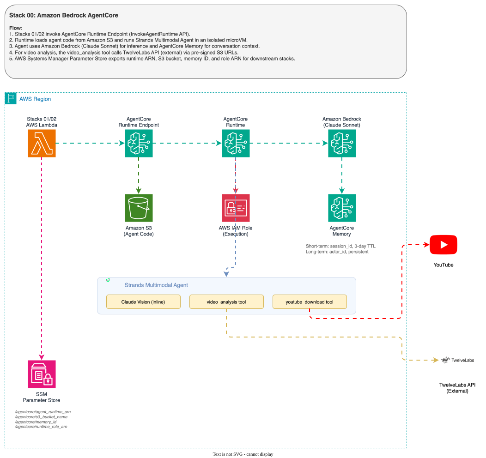

# Amazon Bedrock AgentCore Runtime with a Strands Multimodal Agent

[Amazon Bedrock AgentCore Runtime](https://aws.amazon.com/bedrock/agentcore/?trk=87c4c426-cddf-4799-a299-273337552ad8&sc_channel=el) running a [Strands Agents](https://strandsagents.com/?trk=87c4c426-cddf-4799-a299-273337552ad8&sc_channel=el) multimodal agent, with [AgentCore Memory](https://docs.aws.amazon.com/bedrock-agentcore/latest/devguide/memory.html?trk=87c4c426-cddf-4799-a299-273337552ad8&sc_channel=el), a media bucket and a TwelveLabs secret. This is the foundation stack: stacks 01 and 02 call its runtime.

This sample works with Amazon Bedrock AgentCore.

> Code in this repository is provided "as is", and is not officially supported by Amazon.

| Item | Value |
|------|-------|
| Runtime | Direct code deploy, Python 3.13, arm64, PUBLIC network mode with SigV4 |
| Default model | `global.anthropic.claude-sonnet-4-6` (override with `-c model_id=...`) |
| Agent framework | `strands-agents[otel]==1.64.0`, `bedrock-agentcore[strands-agents]==1.25.3` |
| Memory | Facts, preferences, summaries and episodes, events expire after 30 days by default |
| Tests | 76 offline tests, `cdk synth` without AWS credentials |

## How does it work?



For every request the runtime entrypoint validates the payload, builds a **new** Strands agent with its own AgentCore Memory session manager, runs it, and closes the session manager. A new agent per request avoids `ConcurrencyException` when one microVM serves several sessions. The model client is shared because it is stateless.

The agent has a sliding window conversation manager, turn and token limits, prompt caching, an optional Bedrock Guardrail, and a plugin that redacts tool results and replaces provider errors with generic text. Logs are JSON and hold hashed IDs only.

### What is in the stack?

| Resource | Details |
|----------|---------|
| `CfnRuntime` and endpoint | Python 3.13 zip built for `aarch64-manylinux2014`, request header allowlist for the actor ID header |
| `CfnMemory` | Four strategies with namespaces `/facts/{actorId}/`, `/preferences/{actorId}/`, `/summaries/{actorId}/{sessionId}/`, `/episodes/{actorId}/`; event expiry 3 to 365 days (default 30) |
| Execution roles | Runtime role and memory role with scoped statements and confused-deputy conditions |
| S3 bucket | Versioned, SSL only, public access blocked, lifecycle rules for `images/`, `voice/`, `audio/`, `video/`, `documents/` (30 days by default) |
| Secret | TwelveLabs API key placeholder |
| SSM parameters | The four values below |

Stack outputs: `AgentRuntimeArn`, `AgentRuntimeId`, `EndpointArn`, `MemoryId`, `S3BucketName`, `TwelveLabsSecretArn`.

| SSM parameter | Value |
|---------------|-------|
| `/agentcore/agent_runtime_arn` | Runtime ARN |
| `/agentcore/s3_bucket_name` | Media bucket |
| `/agentcore/memory_id` | Memory ID |
| `/agentcore/runtime_role_arn` | Runtime execution role ARN |

### What are the key files?

| File | Purpose |
|------|---------|
| `agent_files/multimodal_agent.py` | Runtime entrypoint, settings, system prompt, per-request agent |
| `agent_files/agent_helpers.py` | Payload validation, ID rules, memory namespaces, duplicate cache, JSON logging |
| `agent_files/agent_hooks.py` | Strands plugin for tool-call logging and redaction |
| `agent_files/video_analysis_tool.py` | TwelveLabs video tool with timeouts and generic errors |
| `agent_files/link_account_tool.py` | Cross-channel identity linking tool (DynamoDB, table name from SSM at runtime) |
| `agentcore/config.py` | Default model, namespaces, ARN helpers |
| `agentcore/agentcore_*.py` | CDK constructs for runtime, memory and roles |
| `create_deployment_package.sh` | Builds the arm64 zip; rebuilt automatically when sources change |
| `tests/` | pytest suites for helpers, agent wiring, tools and CDK assertions |

## How do I deploy it?

```bash
cd 00-agent-agentcore
uv venv .venv --python 3.11 && source .venv/bin/activate
uv pip install -r requirements.txt
npx aws-cdk@latest deploy          # needs uv on PATH; builds the zip for arm64 and Python 3.13
```

Then store your TwelveLabs key (only needed for video):

```bash
aws secretsmanager put-secret-value --secret-id <TwelveLabsSecretArn output> \
  --secret-string '{"TL_API_KEY":"<your key>"}'
```

The agent creates a TwelveLabs index named `whatsapp-video-index` on first use. Get a key in the [TwelveLabs dashboard](https://dashboard.twelvelabs.io/).

### How do I test it offline?

```bash
uv pip install -r requirements-dev.txt \
  "bedrock-agentcore[strands-agents]==1.25.3" "strands-agents[otel]==1.64.0" \
  twelvelabs==1.3.8 aws-opentelemetry-distro==0.22.0 requests==2.34.2
python -m pytest -q

export AWS_ACCESS_KEY_ID=x AWS_SECRET_ACCESS_KEY=x CDK_DEFAULT_ACCOUNT=123456789012 CDK_DEFAULT_REGION=us-east-1
npx --yes aws-cdk@latest synth --quiet     # first run builds the zip (needs uv and network)
```

Use `-c package_path=<zip>` to skip the build when you already have a package.

### Which options can I change?

CDK context, passed as `cdk deploy -c key=value`:

| Context key | Default | Effect |
|-------------|---------|--------|
| `model_id` | `global.anthropic.claude-sonnet-4-6` | Model or inference profile ID. IAM follows it. Sonnet 5.5 is opt in. Environment variable `MODEL_ID` also works. |
| `memory_expiry_days` | 30 | Short-term event retention, 3 to 365 |
| `enable_summary_memory`, `enable_episodic_memory` | true | Set `false` to drop a strategy |
| `guardrail_id`, `guardrail_version` | none | Apply an existing Bedrock Guardrail |
| `unified_traces_destination` | auto | Force the span log group on or off |
| `media_retention_days` | 30 | Expiration of media prefixes in the bucket |
| `package_path` | built | Prebuilt deployment zip |

Runtime environment variables set by the stack: `AWS_REGION`, `MODEL_ID`, `BEDROCK_AGENTCORE_MEMORY_ID`, `S3_BUCKET`, `TL_SECRET_ARN`, `TL_MODEL_NAME` (default `pegasus1.2`), and the optional Guardrail and traces values. Optional tuning (not set by default): `ENABLE_PROMPT_CACHING` (true), `AGENT_MAX_TURNS` (12), `AGENT_MAX_TOTAL_TOKENS` (200000), `AGENT_WINDOW_SIZE` (40), `LINK_ALLOW_MERGE` (true), `LOG_LEVEL`.

## How is the payload structured?

`InvokeAgentRuntime` receives JSON. The session ID comes from `runtimeSessionId`.

| Media | Payload |
|-------|---------|
| Text | `{"prompt": "Hello", "actor_id": "wa-user-...", "idempotency_key": "<message id>"}` |
| Image | add `"media": {"type": "image", "format": "png", "data": "<base64>"}` |
| Document | add `"media": {"type": "document", "format": "pdf", "data": "<base64>", "name": "report"}` |
| Video | add `"media": {"type": "video", "s3_uri": "s3://bucket/video/file.mp4"}` |
| Audio | `"media": {"type": "audio_transcript", "data": "<text>"}` (the Lambda transcribes first) |

Rules enforced before the model is called: decoded media up to about 1.5 MB, supported formats only, IDs padded to 33 characters, text block first in multimodal messages. The same `idempotency_key` returns the cached answer, which protects against retried deliveries.

## How do I see what the agent does?

The runtime ships OpenTelemetry data through `aws-opentelemetry-distro` and writes JSON logs. To view traces and spans, enable [CloudWatch Transaction Search](https://docs.aws.amazon.com/bedrock-agentcore/latest/devguide/observability-configure.html?trk=87c4c426-cddf-4799-a299-273337552ad8&sc_channel=el) once per account. Without it, logs and metrics still work.

## What are the next steps?

This stack does not deploy [AgentCore Gateway](https://docs.aws.amazon.com/bedrock-agentcore/latest/devguide/gateway.html?trk=87c4c426-cddf-4799-a299-273337552ad8&sc_channel=el), [AgentCore Identity](https://docs.aws.amazon.com/bedrock-agentcore/latest/devguide/identity.html?trk=87c4c426-cddf-4799-a299-273337552ad8&sc_channel=el), policy or [Evaluations](https://docs.aws.amazon.com/bedrock-agentcore/latest/devguide/evaluations.html?trk=87c4c426-cddf-4799-a299-273337552ad8&sc_channel=el). They are natural additions: Gateway for tools behind an MCP endpoint, Identity for the credentials those tools need, Evaluations to score conversations after prompt or model changes.

## Troubleshooting

| Symptom | Resolution |
|---------|------------|
| The runtime fails to start | The entrypoint file must end with `app.run()`, and the zip must keep all dependencies. Do not exclude packages in `create_deployment_package.sh`. |
| `cdk synth` cannot build the package | Install `uv`, allow network access, or use `-c package_path`. |
| `AccessDeniedException` for the model | Enable model access in Bedrock and check that `model_id` is available in your Region. |
| New code is not used | Wait 15 minutes for idle sessions to end, or use a new session ID. |
| Memory has no facts yet | Extraction is asynchronous and can take a few minutes. |
| Large image gets a "too large" reply | Decoded media is limited to about 1.5 MB. |

## Frequently asked questions

**Why is the agent rebuilt for every request?**
A runtime microVM can serve several sessions and a Strands agent rejects overlapping calls on one instance. A per-request agent also keeps each session's memory separate.

**Can I use a different model?**
Yes: `-c model_id=<id>`. The execution role and the memory role are scoped to the model you choose. Check the [model lifecycle page](https://docs.aws.amazon.com/bedrock/latest/userguide/model-lifecycle.html?trk=87c4c426-cddf-4799-a299-273337552ad8&sc_channel=el) for end-of-life dates.

**Is the video tool required?**
No. Without a TwelveLabs key the other media types work, and the video tool answers with a generic error.

**Does the runtime store the user's messages?**
Messages enter AgentCore Memory (events, then extracted records). Logs do not contain message text.

---

## Contributing

Contributions are welcome! See [CONTRIBUTING](../CONTRIBUTING.md) for more information.

---

## Security

If you discover a potential security issue in this project, notify AWS/Amazon Security via the [vulnerability reporting page](http://aws.amazon.com/security/vulnerability-reporting/). Please do **not** create a public GitHub issue.

---

## License

This library is licensed under the MIT-0 License. See the [LICENSE](../LICENSE) file for details.
