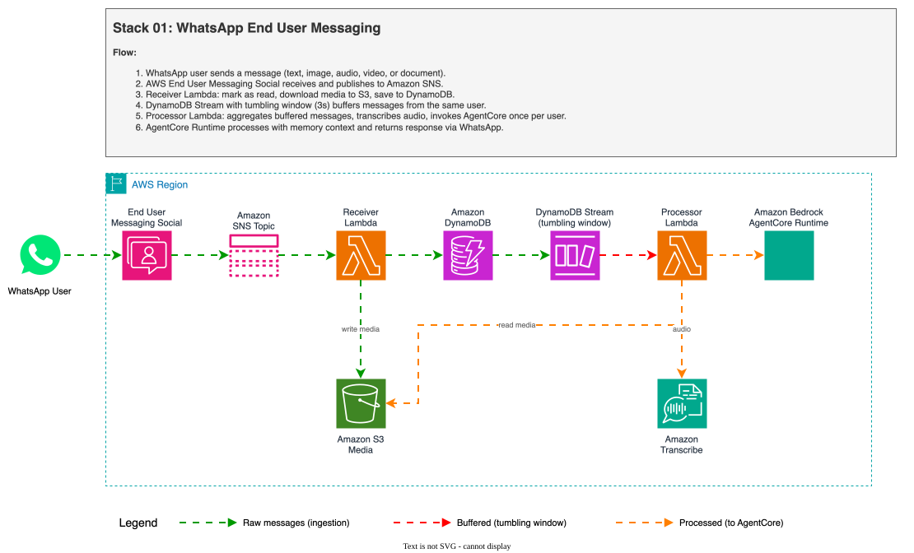

# WhatsApp Multimodal AI Agent with AWS End User Messaging Social and Amazon Bedrock AgentCore

Process text, images, video, audio, and documents from WhatsApp using a 2-Lambda architecture with [DynamoDB Streams](https://docs.aws.amazon.com/amazondynamodb/latest/developerguide/Streams.html?trk=87c4c426-cddf-4799-a299-273337552ad8&sc_channel=el) tumbling window for message buffering. [AWS End User Messaging Social](https://aws.amazon.com/end-user-messaging/?trk=87c4c426-cddf-4799-a299-273337552ad8&sc_channel=el) provides direct WhatsApp integration without additional API layers.

[AWS Lambda](https://aws.amazon.com/lambda/?trk=87c4c426-cddf-4799-a299-273337552ad8&sc_channel=el) handles message reception and processing, while [Amazon Bedrock AgentCore Runtime](https://aws.amazon.com/bedrock/agentcore/?trk=87c4c426-cddf-4799-a299-273337552ad8&sc_channel=el) with [Amazon Bedrock AgentCore Memory](https://docs.aws.amazon.com/bedrock-agentcore/latest/devguide/memory.html?trk=87c4c426-cddf-4799-a299-273337552ad8&sc_channel=el) provides persistent conversation context.

This sample works with Amazon Bedrock AgentCore.

> Code in this repository is provided "as is", and is not officially supported by Amazon.

> Your data will be securely stored in your AWS account and will not be shared or used for model training. It is not recommended to share private information because the security of data with WhatsApp is not guaranteed.

| Voice notes | Image |
|----------|------------|
||  |

| Video | Document |
|--------------|--------------|
|||

✅ **AWS Level**: Advanced - 300

**Prerequisites:**

- [AWS Account](https://aws.amazon.com/resources/create-account/?trk=87c4c426-cddf-4799-a299-273337552ad8&sc_channel=el)
- [Foundational knowledge of Python](https://catalog.us-east-1.prod.workshops.aws/workshops/3d705026-9edc-40e8-b353-bdabb116c89c/?trk=87c4c426-cddf-4799-a299-273337552ad8&sc_channel=el)
- [AWS CLI configured](https://docs.aws.amazon.com/cli/v1/userguide/cli-chap-configure.html?trk=87c4c426-cddf-4799-a299-273337552ad8&sc_channel=el) with appropriate permissions
- [Python 3.11](https://www.python.org/downloads/) or later and Node.js for `npx aws-cdk@latest` (the Lambda functions run on Python 3.13, arm64)
- [AWS Cloud Development Kit (CDK)](https://docs.aws.amazon.com/cdk/v2/guide/getting_started.html?trk=87c4c426-cddf-4799-a299-273337552ad8&sc_channel=el) v2 or later
- [Have or create a Meta Business Account](https://docs.aws.amazon.com/social-messaging/latest/userguide/getting-started-whatsapp.html#getting-started-embedded?trk=87c4c426-cddf-4799-a299-273337552ad8&sc_channel=el)
- Stack `00-agent-agentcore` deployed (provides SSM parameters)
- [TwelveLabs](https://www.twelvelabs.io/) API key for video analysis (free account at [twelvelabs.io](https://www.twelvelabs.io/))

## How does the application work?



### What infrastructure is deployed?

This stack deploys two Lambda functions, a DynamoDB table with Streams, an S3 bucket, and an SNS topic, all connected to Amazon Bedrock AgentCore. The project uses [AWS Cloud Development Kit (AWS CDK)](https://aws.amazon.com/cdk/?trk=87c4c426-cddf-4799-a299-273337552ad8&sc_channel=el) to define and deploy the following resources:

- [AWS Lambda](https://docs.aws.amazon.com/lambda/latest/dg/welcome.html?trk=87c4c426-cddf-4799-a299-273337552ad8&sc_channel=el):
  - `webhook_receiver`: Receives WhatsApp messages via SNS, downloads media to S3, saves to DynamoDB for buffering.
  - `message_processor`: Triggered by DynamoDB Stream tumbling window, aggregates messages, transcribes audio, invokes AgentCore, sends reply.

- [Amazon Simple Storage Service (Amazon S3)](https://aws.amazon.com/s3/?trk=87c4c426-cddf-4799-a299-273337552ad8&sc_channel=el):
  - Bucket for storing media files, organized by type: `images/`, `voice/`, `video/`, `documents/`.

- [Amazon DynamoDB](https://aws.amazon.com/dynamodb/?trk=87c4c426-cddf-4799-a299-273337552ad8&sc_channel=el):
  - Message buffer with [DynamoDB Streams](https://docs.aws.amazon.com/amazondynamodb/latest/developerguide/Streams.html?trk=87c4c426-cddf-4799-a299-273337552ad8&sc_channel=el) and tumbling window for message aggregation.
  - Partition key `from_phone` ensures messages from the same user land in the same shard.
  - TTL for automatic cleanup of processed messages.

- [Amazon Simple Notification Service (Amazon SNS)](https://aws.amazon.com/sns/?trk=87c4c426-cddf-4799-a299-273337552ad8&sc_channel=el):
  - Topic for receiving WhatsApp events from AWS End User Messaging Social.

- [Amazon Bedrock AgentCore](https://aws.amazon.com/bedrock/agentcore/?trk=87c4c426-cddf-4799-a299-273337552ad8&sc_channel=el):
  - Runtime invocation for processing all message types with multimodal Strands agent.
  - Memory for persistent conversation context (short-term + long-term).

- [Amazon Transcribe](https://aws.amazon.com/transcribe/?trk=87c4c426-cddf-4799-a299-273337552ad8&sc_channel=el):
  - Used for transcribing audio/voice messages before sending to the agent.

- [AWS End User Messaging Social](https://aws.amazon.com/end-user-messaging/?trk=87c4c426-cddf-4799-a299-273337552ad8&sc_channel=el):
  - Natively links WhatsApp Business Account (WABA) and AWS account.

### How does data flow through the system?

Messages flow from WhatsApp through AWS End User Messaging Social to SNS, then through a 2-Lambda pipeline with DynamoDB buffering before reaching Amazon Bedrock AgentCore.

1. User sends a WhatsApp message.
2. Message is received by AWS End User Messaging Social and published to the Amazon SNS Topic.
3. `webhook_receiver` Lambda is triggered: marks as read, sends reaction, downloads media to S3, saves to DynamoDB (`PENDING`).
4. DynamoDB Streams captures the INSERT event and accumulates records in a tumbling window.
5. After the 20-second tumbling window fires, `message_processor` Lambda is invoked:
   - Receives all buffered records from the tumbling window.
   - Queries all `PENDING` messages for the phone number.
   - Aggregates text messages (joined with newlines) and selects the last media item.
   - Processes media based on type:
     - **Text**: Sent directly to Amazon Bedrock AgentCore Runtime.
     - **Audio**: Transcribed using [Amazon Transcribe](https://aws.amazon.com/transcribe/?trk=87c4c426-cddf-4799-a299-273337552ad8&sc_channel=el), then the transcript is sent as text to the agent.
     - **Image**: Downloaded from S3, base64-encoded, sent as inline content block to the agent (Claude vision).
     - **Video**: S3 URI sent to the agent which uses the `video_analysis` tool ([TwelveLabs Pegasus](https://docs.twelvelabs.io/docs/concepts/models) via [TwelveLabs API](https://www.twelvelabs.io/)).
     - **Document**: Downloaded from S3, base64-encoded, sent as inline document block to the agent.
6. Amazon Bedrock AgentCore Runtime processes the aggregated message with [Amazon Bedrock AgentCore Memory](https://docs.aws.amazon.com/bedrock-agentcore/latest/devguide/memory.html?trk=87c4c426-cddf-4799-a299-273337552ad8&sc_channel=el) context.
7. Response is sent back to the user via WhatsApp.

### How does message buffering work?

A [DynamoDB Streams tumbling window](https://docs.aws.amazon.com/lambda/latest/dg/with-ddb.html#services-ddb-windows?trk=87c4c426-cddf-4799-a299-273337552ad8&sc_channel=el) aggregates multiple rapid WhatsApp messages into a single agent invocation. When users send multiple messages in quick succession (common in WhatsApp), the tumbling window accumulates them before processing. This reduces token usage and AgentCore Runtime costs.

**How it works:**

1. Each incoming message is saved to DynamoDB with `from_phone` as partition key.
2. DynamoDB Streams captures the INSERT event.
3. The Lambda event source mapping uses a **tumbling window** (`tumbling_window` + `max_batching_window`) to accumulate records for N seconds before invoking the processor.
4. Since all messages from the same phone share the same partition key, they land in the same shard and are processed together.
5. The processor groups by sender, concatenates text messages with newlines, and invokes AgentCore once per sender.

```
User sends 3 messages in 2 seconds:
  "hola"           -> DDB INSERT (t=0s)
  "tengo una duda" -> DDB INSERT (t=1s)
  "sobre mi video" -> DDB INSERT (t=2s)

Tumbling window fires at t=20s:
  -> Processor receives all 3 records in one batch
  -> Aggregates: "hola\ntengo una duda\nsobre mi video"
  -> Single AgentCore invocation
```

The buffer duration is configurable in the CDK construct (default: 20 seconds).

> This buffering technique is based on [sample-whatsapp-end-user-messaging-connect-chat](https://github.com/aws-samples/sample-whatsapp-end-user-messaging-connect-chat), which demonstrates DynamoDB Streams with tumbling windows for WhatsApp message aggregation. That project reports reducing ~1,000 raw messages to ~250 aggregated messages (4:1 ratio), yielding approximately 75% cost savings on downstream processing. In our case, the savings apply to AgentCore Runtime invocations and LLM token usage.

### How are media files organized in S3?

```
s3://media-bucket/
├── images/       ← WhatsApp image attachments
├── voice/        ← Voice messages and audio
├── video/        ← Video files (read by AgentCore Runtime for analysis)
└── documents/    ← PDF, DOCX, and other documents
```

### What are the pricing considerations?

- [Amazon Bedrock Pricing](https://aws.amazon.com/bedrock/pricing/?trk=87c4c426-cddf-4799-a299-273337552ad8&sc_channel=el)
- [AWS Lambda Pricing](https://aws.amazon.com/lambda/pricing/?trk=87c4c426-cddf-4799-a299-273337552ad8&sc_channel=el)
- [Amazon Transcribe Pricing](https://aws.amazon.com/transcribe/pricing/?trk=87c4c426-cddf-4799-a299-273337552ad8&sc_channel=el)
- [Amazon S3 Pricing](https://aws.amazon.com/s3/pricing/?trk=87c4c426-cddf-4799-a299-273337552ad8&sc_channel=el)
- [Amazon DynamoDB Pricing](https://aws.amazon.com/dynamodb/pricing/?trk=87c4c426-cddf-4799-a299-273337552ad8&sc_channel=el)
- [AWS End User Messaging Pricing](https://aws.amazon.com/end-user-messaging/pricing/?trk=87c4c426-cddf-4799-a299-273337552ad8&sc_channel=el)
- [Amazon Simple Notification Service Pricing](https://aws.amazon.com/sns/pricing/?trk=87c4c426-cddf-4799-a299-273337552ad8&sc_channel=el)
- [WhatsApp pricing](https://developers.facebook.com/docs/whatsapp/pricing/)

### What are the key files?

| File | Purpose |
|------|---------|
| `app.py` | Entry point of the CDK app |
| `whatsapp_end_user_messaging/whatsapp_stack.py` | Stack: SSM parameters, bucket, table, topic, Lambdas, outputs |
| `whatsapp_end_user_messaging/config.py` | Graph API version (`v25.0`), TTL, media limit, context helpers |
| `topic/topic.py` | SNS topic; only `social-messaging.amazonaws.com` of this account may publish |
| `lambdas/project_lambdas.py` | Both Lambdas (Python 3.13, arm64, tracing), queues, event source mapping, scoped IAM |
| `lambdas/code/whatsapp_handler/` | Receiver: checks the SNS record, downloads media to S3, conditional put in DynamoDB |
| `lambdas/code/message_processor/` | Processor: claims messages, aggregates, transcribes, invokes AgentCore, replies |
| `tests/` | 41 offline tests: helpers, idempotency, receiver, processor, CDK assertions |

### How are errors and retries handled?

- The receiver does a conditional put on `(from_phone, id)`. A redelivered SNS message does not create a second item.
- The processor claims each message (`proc_state` processing, then done) and releases the claim on failure, so a tumbling window that delivers a record twice does not answer twice.
- The stream source has a retry limit, a record age limit, bisect on error and an SQS on-failure destination (`ProcessorFailureQueueUrl`). The processor returns the tumbling window `state` and partial `batchItemFailures`.
- The receiver has a dead-letter queue (`HandlerDeadLetterQueueUrl`) and two retries.
- AgentCore calls are retried with backoff for 424, 429 and 500 responses. If they still fail, the user gets a short fallback message.
- Messages larger than the inline media limit (about 1.5 MB) get a friendly "too large" reply.

### How is data protected?

- No public endpoint: SNS delivers to Lambda with IAM. The receiver also rejects records whose `EventSource` is not `aws:sns` or whose topic ARN differs from `EXPECTED_TOPIC_ARN`.
- IAM is scoped: `social-messaging` actions to the phone number ARN pattern, Transcribe to `whatsapp-audio-*` jobs, invoke permissions to the runtime ARN.
- Logs are JSON with message IDs, counts and exception types. Phone numbers are masked and message text is never logged.
- The table uses server-side encryption and a 48 hour TTL; the bucket expires media after 30 days. Context `retain_data=true` switches table and bucket to RETAIN with deletion protection and point-in-time recovery.

## How do I deploy this stack?

Deploy `00-agent-agentcore` first. This stack reads `/agentcore/agent_runtime_arn` and `/agentcore/runtime_role_arn` from SSM when CloudFormation deploys, not when you synthesize.

```bash
git clone https://github.com/aws-samples/whatsapp-ai-agent-sample-for-aws-agentcore
cd whatsapp-ai-agent-sample-for-aws-agentcore/01-whatsapp-end-user-messaging
uv venv .venv --python 3.11 && source .venv/bin/activate
uv pip install -r requirements.txt
npx aws-cdk@latest deploy
```

Note the `WhatsAppTopicArn` output; you choose it as the event destination in the next section.

### How do I test it without AWS credentials?

```bash
uv pip install -r requirements-dev.txt
python -m pytest -q
export AWS_ACCESS_KEY_ID=x AWS_SECRET_ACCESS_KEY=x CDK_DEFAULT_ACCOUNT=123456789012 CDK_DEFAULT_REGION=us-east-1
npx --yes aws-cdk@latest synth --quiet
```

### Which options can I change?

CDK context, passed as `cdk deploy -c key=value`:

| Context key | Default | Effect |
|-------------|---------|--------|
| `meta_api_version` | `v25.0` | Graph API version sent to End User Messaging Social. Change it if the service rejects it in your Region. |
| `media_retention_days` | 30 | Expiration of media in the bucket |
| `retain_data` | false | `true` keeps table and bucket on stack deletion and enables deletion protection and PITR |
| `processor_reserved_concurrency` | unset | Reserved concurrency for the processor Lambda |
| `topic_source_arn_pattern` | unset | Adds an `aws:SourceArn` condition to the topic policy |

The buffer window is 20 seconds (`buffer_seconds` argument of the Lambda construct).

## How do I configure WhatsApp integration?

### Step 0: Activate WhatsApp account

1. [Get Started with the New WhatsApp Business Platform](https://www.youtube.com/watch?v=CEt_KMMv3V8&list=PLX_K_BlBdZKi4GOFmJ9_67og7pMzm2vXH&index=2&t=17s&pp=gAQBiAQB)
2. [How To Generate a Permanent Access Token for the WhatsApp API](https://www.youtube.com/watch?v=LmoiCMJJ6S4&list=PLX_K_BlBdZKi4GOFmJ9_67og7pMzm2vXH&index=1&t=158s&pp=gAQBiAQB)

### Step 1: AWS End User Messaging Social Set Up

Set up a WhatsApp Business account by following the [Getting started with AWS End User Messaging Social steps](https://docs.aws.amazon.com/social-messaging/latest/userguide/getting-started-whatsapp.html?trk=87c4c426-cddf-4799-a299-273337552ad8&sc_channel=el) and configure it to send messages to the [Amazon SNS Topic](https://console.aws.amazon.com/sns/home?trk=87c4c426-cddf-4799-a299-273337552ad8&sc_channel=el) created by this stack.

> You can also follow the more detailed steps in [Automate workflows with WhatsApp using AWS End User Messaging Social blog](https://aws.amazon.com/blogs/messaging-and-targeting/whatsapp-aws-end-user-messaging-social/?trk=87c4c426-cddf-4799-a299-273337552ad8&sc_channel=el).

### Step 2: Deploy Stack 00 (AgentCore) first

This stack depends on the Amazon Bedrock AgentCore Runtime deployed in `00-agent-agentcore`. Make sure it is deployed and the SSM parameters are available:

- `/agentcore/agent_runtime_arn`
- `/agentcore/runtime_role_arn`

### Step 3: Test

1. Send a WhatsApp message to the configured phone number.
2. Text messages are sent directly to the Amazon Bedrock AgentCore Runtime.
3. Audio messages are transcribed using Amazon Transcribe, then sent to the agent.
4. Images, videos, and documents are downloaded to Amazon S3 and processed by the agent.
5. The response is sent back to the user via WhatsApp.

## How do I clean up resources?

If you finish testing and want to clean the application:

1. Run this command in your terminal:

```bash
npx aws-cdk@latest destroy
```

The bucket is created with `auto_delete_objects`, so `destroy` empties it first. If you deployed with `-c retain_data=true`, the table and the bucket stay in your account; delete them yourself when you are done.

## Troubleshooting

| Symptom | Resolution |
|---------|------------|
| `cdk deploy` cannot find an SSM parameter | Deploy stack 00 first, in the same account and Region. |
| No reply on WhatsApp | Check that `WhatsAppTopicArn` is the event destination in End User Messaging Social, then read the receiver and processor log groups in CloudWatch Logs. |
| Messages are dropped by the receiver | The record did not come from the expected topic. Check `EXPECTED_TOPIC_ARN` and the topic policy. |
| `ProcessorFailureQueueUrl` has messages | The stream batch failed repeatedly. Inspect the processor logs for the exception type. |
| Reply says the file is too large | Media above about 1.5 MB is not sent to the agent. Send a smaller file. |
| The service rejects the API version | Deploy with `-c meta_api_version=<version>` for a version your Region supports. |
| Agent seems to use old code | Wait 15 minutes for idle sessions to end or use a new session. |

## Frequently asked questions

**Do I need a Meta app for this stack?**
No. AWS End User Messaging Social links your WhatsApp Business Account to AWS. You still need a Meta Business Account.

**Why is the processor Lambda timeout 10 minutes?**
It may transcribe audio (up to 2 minutes) and wait for the agent. It stops starting new AgentCore calls when less than 30 seconds remain.

**Is a message answered twice if Lambda retries?**
No. The conditional put and the per-message claim make the flow idempotent.

**Can I use Instagram with this stack?**
No. Instagram DMs need the Meta webhook in `02-multichannel-api-gateway`.

**What did I not verify?**
This README was checked against the code and `cdk synth` only. The End User Messaging Social calls, WhatsApp delivery and the AgentCore runtime were not run in a live account. See [docs/AUDIT.md](../docs/AUDIT.md).

## Where can I learn more?

- [Automate workflows with WhatsApp using AWS End User Messaging Social](https://aws.amazon.com/blogs/messaging-and-targeting/whatsapp-aws-end-user-messaging-social/?trk=87c4c426-cddf-4799-a299-273337552ad8&sc_channel=el)
- [Amazon Bedrock AgentCore documentation](https://docs.aws.amazon.com/bedrock-agentcore/latest/devguide/?trk=87c4c426-cddf-4799-a299-273337552ad8&sc_channel=el)
- [Strands Agents documentation](https://strandsagents.com/?trk=87c4c426-cddf-4799-a299-273337552ad8&sc_channel=el)
- [Amazon Bedrock AgentCore Runtime Sessions](https://docs.aws.amazon.com/bedrock-agentcore/latest/devguide/runtime-sessions.html?trk=87c4c426-cddf-4799-a299-273337552ad8&sc_channel=el)
- [Amazon Bedrock AgentCore Memory](https://docs.aws.amazon.com/bedrock-agentcore/latest/devguide/memory.html?trk=87c4c426-cddf-4799-a299-273337552ad8&sc_channel=el)

---

## Contributing

Contributions are welcome! See [CONTRIBUTING](../CONTRIBUTING.md) for more information.

---

## Security

If you discover a potential security issue in this project, notify AWS/Amazon Security via the [vulnerability reporting page](http://aws.amazon.com/security/vulnerability-reporting/). Please do **not** create a public GitHub issue.

---

## License

This library is licensed under the MIT-0 License. See the [LICENSE](../LICENSE) file for details.
